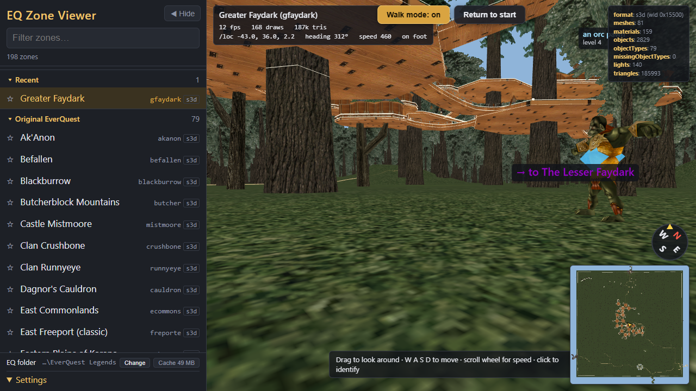
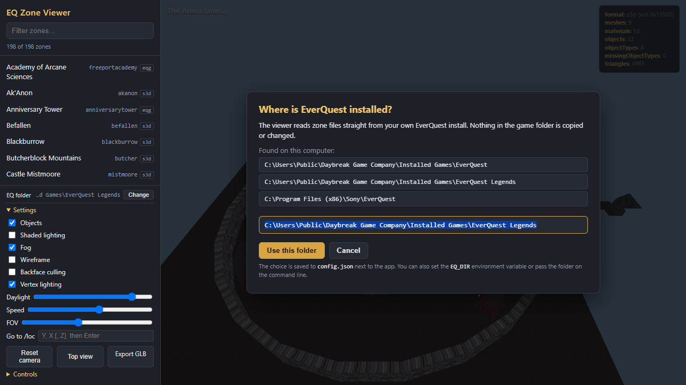

# EQ Zone Viewer

Browse EverQuest zones in 3D, straight from your own copy of the game. Pick a zone from the list,
fly around it with a free camera, jump to an in-game `/loc`, or export it as glTF for Blender.



> **You need your own EverQuest install.** This project ships **no game data**. It reads the zone
> archives (`.s3d` / `.eqg`) from the EverQuest folder on your computer and converts them in memory.
> Nothing in the game folder is copied, extracted or modified.
>
> EverQuest is a trademark of Daybreak Game Company LLC. This is an unofficial fan tool and is not
> affiliated with or endorsed by Daybreak.

## Quick start

### Option 1: download the Windows release (nothing to install)

1. Download `eq-zone-viewer-<version>-win-x64.zip` from the
   [Releases page](https://github.com/nathandace/eq-zone-viewer/releases) and unzip it anywhere.
2. Run `eq-zone-viewer.exe`. A console window opens and your browser opens the viewer at
   <http://localhost:3080/>.
3. If the viewer could not find EverQuest on its own it asks for the game folder (the one that contains
   `eqgame.exe`). The choice is saved to `config.json` next to the exe.
4. Click a zone. The first visit converts it, which takes a few seconds for big zones; after that it
   loads from the `cache` folder next to the exe.
5. Close the console window (or press Ctrl+C in it) to stop the viewer.

The exe is a stock Node.js runtime with this project embedded in it, produced by `npm run release`
(see [Development](#development)). It is not code-signed, so Windows SmartScreen may show a warning the
first time; choose "More info" and then "Run anyway".



### Option 2: run from source (Windows, macOS, Linux)

Requires [Node.js](https://nodejs.org/) 22.18 or newer (24 recommended); the server runs the TypeScript
sources directly, so there is no compile step for the server.

```
git clone https://github.com/nathandace/eq-zone-viewer.git
cd eq-zone-viewer
npm install
npm start
```

Then open <http://localhost:3080/>. On Windows, double-clicking `start.cmd` does the same and opens the
browser for you.

## Pointing it at your EverQuest folder

The viewer looks for the game in this order and uses the first folder that contains `.s3d` / `.eqg` files:

1. A folder on the command line: `eq-zone-viewer.exe "D:\Games\EverQuest"` or
   `node src/server/main.ts "D:\Games\EverQuest"`.
2. The `EQ_DIR` environment variable.
3. `eqDir` in `config.json` next to the app (see `config.example.json`).
4. Common install locations: Daybreak launcher installs under
   `C:\Users\Public\Daybreak Game Company\Installed Games`, Steam library folders, older Sony installs,
   `C:\EverQuest`, and the usual Steam paths under your home folder on macOS and Linux.

If nothing is found the viewer opens with a folder chooser. The **Change** button at the bottom of the zone
list switches to another install at any time; every install gets its own cache. Any client that has
`.s3d` / `.eqg` zone archives should work (Live, Test, progression servers, emulator clients). The parsers
were developed against a current Live-era install, so older clients have had less testing.

Other settings:

| Setting | How | Default |
| --- | --- | --- |
| Port | `PORT` environment variable or `"port"` in `config.json`. If the port is busy the next free one is used. | `3080` |
| Listen address | `HOST=0.0.0.0` to reach the viewer from other machines on your network. | `127.0.0.1` (this machine only) |
| Browser | The exe opens one automatically; pass `--no-open` to skip that. From source, pass `--open` to get the same. | |

## Using the viewer

Drag in the 3D view with the left or right mouse button to look around. The cursor is never captured, so
the menu is always one click away.

| Keys | Action |
| --- | --- |
| **W A S D** or arrow keys | Move |
| **E** / **Space** | Up |
| **Q** / **C** | Down |
| **Shift** / **Ctrl** | Fast / slow |
| Mouse wheel | Change movement speed |
| **R** | Return to the zone's start point (standing on the ground in walk mode) |
| **T** | Top-down view of the whole zone |
| **O** | Toggle placed objects (trees, rocks, furniture) |
| **G** | Toggle walk mode (see below); **Space** jumps while walking |

The **Settings** panel has:

- **Objects**: show or hide placed objects.
- **Shaded lighting**: a simple directional light instead of the flat, in-game look.
- **Fog**: distance fog sized to the zone.
- **Wireframe** and **Backface culling**: handy for finding geometry problems.
- **Vertex lighting**: EverQuest bakes torches, lamps and shadows into vertex colors; turn this off to see
  the raw textures.
- **Walk mode**: off by default, so the camera flies freely through everything. Turn it on with the
  **Walk mode** button at the top of the view (or **G**) to explore on foot like a character: gravity
  pulls you to the ground, walls and objects block you, small steps and slopes are climbed, and Space
  jumps. Shift sprints, Ctrl walks slowly. Under water you swim: you move in the direction you look,
  E or Space swims up, Q or C dives, nothing pulls you down, and walking up the bank brings you back
  out. Falling out of the world puts you back at the zone's start point, and picking another zone
  switches walk mode off again.
- **Return to start** (button at the top of the view, or **R**): back to the zone's start point, on the
  ground when walking.
- **Daylight**: ambient light level. Lower it in a classic zone to see the baked-in lamps and torches.
- **Speed** and **FOV** sliders.
- **Go to /loc**: paste the numbers from the in-game `/loc` command (`Y, X` and optionally `Z`) and press
  Enter; without `Z` the camera is placed on the ground at that spot.
- **Return to start**, **Top view**, and **Export GLB**, which downloads the zone as a standard glTF binary
  that Blender, Windows 3D Viewer and most engines can open.

The top-right box lists build statistics and any warnings (for example textures the viewer could not find).

### Bookmarkable URLs

Everything after `#` in the address bar restores a view, so links can be shared or bookmarked:

| Parameter | Meaning |
| --- | --- |
| `zone=gfaydark` | Zone short name |
| `loc=Y,X[,Z]` | Start at an in-game `/loc` |
| `cam=x,y,z,yaw,pitch` | Exact camera position (viewer coordinates, radians) |
| `yaw=`, `pitch=` | Camera angles only |
| `view=top` | Top-down view |
| `amb=0..1` | Daylight slider |
| `objects=0`, `lit=1`, `fog=0` | Toggle objects, shaded lighting and fog |
| `walk=1` | Start in walk mode |
| `setup=1` | Open the folder chooser |

Example: `http://localhost:3080/#zone=gfaydark&loc=-1200,500` drops you on the ground in Greater Faydark.

## What is supported

- **Classic archives** (`.s3d` with WLD geometry, both the 0x15500 and 0x1000C800 WLD versions): the zone
  mesh, placed objects (`objects.wld` plus `*_obj.s3d`), skeleton-posed objects, vertex colors,
  masked / blended / additive materials and animated textures (water, lava, fire).
- **EQG archives**: binary `.zon` v1 / v2 with `.ter` terrain and `.mod` / `.mds` objects (including
  `*_assets.txt` dependencies), and v4 text `.zon` with heightmap `.dat` terrain, ECO terrain materials,
  TOG object groups and water sheets.
- **Textures**: DDS (DXT1 / 3 / 5 and uncompressed) and BMP (paletted, 16 / 24 / 32-bit), converted to PNG
  on the fly and downsized to at most 2048 pixels.

Every zone archive in a current Live install (612 zones) and in a progression-era install (198 zones)
builds and renders; a few dozen of them report textures that could not be found, which show up in the
warnings box. Not supported (yet): character and NPC models, dynamic lights, particles, sounds and zone
lines. If a zone fails to build or looks
wrong, please [open an issue](https://github.com/nathandace/eq-zone-viewer/issues) with the zone name,
which client you have, and the error shown in the viewer.

## How it works

A small Node.js server opens the game's PFS archives, parses the WLD or EQG data inside, and converts each
zone into a glTF binary (GLB). Textures are decoded to PNG as the browser asks for them. The browser side is
a [three.js](https://threejs.org/) viewer with a free-fly camera and a custom shader that reproduces
EverQuest's baked vertex lighting.

Converted zones and textures are cached under `cache/` (next to the exe, or in the project folder when
running from source). Delete that folder to force a rebuild; it is regenerated on demand. Each EverQuest
install gets its own cache sub-folder, and the cache is tagged with a build version so parser changes
invalidate it automatically.

Coordinates: EverQuest stores positions as (north, west, up). The viewer maps that to glTF space as
x = north, y = up, z = east, which is why the `/loc` readout in the status line matches the game.

## Development

```
npm install          # once
npm start            # build the browser bundle and start the server on http://localhost:3080/
npm run dev          # start the server without rebuilding the bundle
npm run build        # rebuild public/bundle.js only
npm run typecheck    # tsc --noEmit over src/ and tools/
npm run build-all    # build every zone without the server and write cache/build-report.json
npm run release      # self-contained executable + zip under release/
```

Layout:

- `src/server/main.ts`: HTTP server and the `/api/...` endpoints.
- `src/server/config.ts`: finding the EverQuest folder, `config.json`, command-line flags.
- `src/server/pfs.ts`: reader for the PFS archive format used by `.s3d` and `.eqg` files.
- `src/server/wld.ts`, `build-s3d.ts`: classic WLD parser and zone builder.
- `src/server/eqg.ts`, `build-eqg.ts`: EQG parsers (`.zon`, `.ter`, `.mod`, `.mds`, `.dat`, `.eco`, `.tog`)
  and zone builder.
- `src/server/scene.ts`, `gltf.ts`: the intermediate scene model and the GLB writer.
- `src/server/textures.ts`: DDS and BMP decoders, PNG encoder.
- `src/server/zones.ts`: zone discovery and long names.
- `src/client/main.ts`: the three.js viewer, bundled to `public/bundle.js` by esbuild.
- `tools/`: `survey.ts` (format census of an install), `inspect.ts` (parser checks),
  `build-all.ts` (builds every zone and reports failures), `shot.sh` (headless screenshots of the
  running viewer), `release.ts` (release build).

After changing a parser, bump `BUILD_VERSION` in `src/server/main.ts` (or delete `cache/`) so stale builds
are not served, and run `npm run build-all` to make sure every zone still builds.

### Release builds

`npm run release` bundles the server and the viewer with esbuild, embeds them in a copy of the running
Node.js binary using Node's single-executable-application support, and zips the result with the docs.
It is built for whatever platform runs it; the GitHub Actions workflow in `.github/workflows/release.yml`
builds the Windows x64 zip and attaches it to a release whenever a `v*` tag is pushed:

```
git tag v0.1.0
git push origin v0.1.0
```

## License

[MIT](LICENSE). EverQuest and all game content remain the property of Daybreak Game Company LLC; this
project contains none of it. The file formats were worked out from the game's own data with help from the
EverQuest community's long history of reverse engineering (EQEmu, Lantern Extractor and others).
